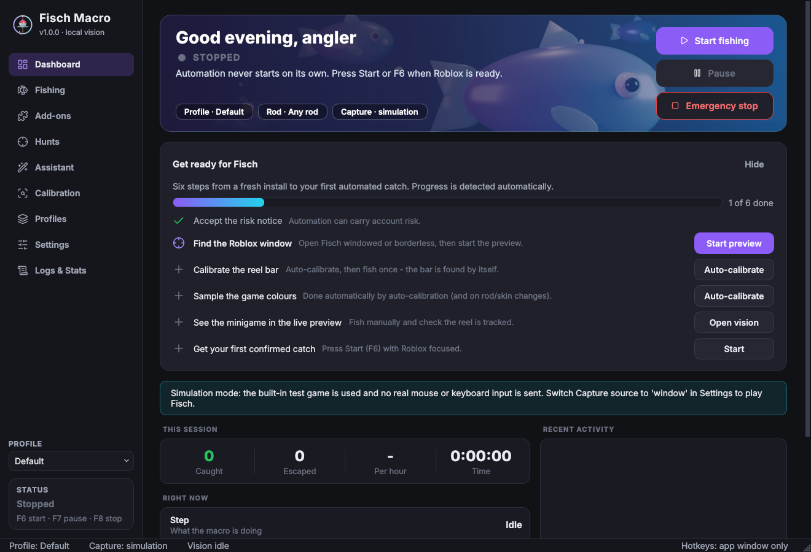
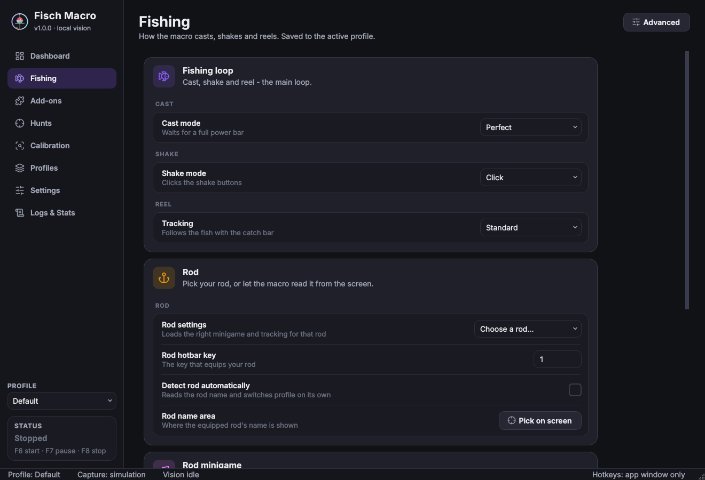
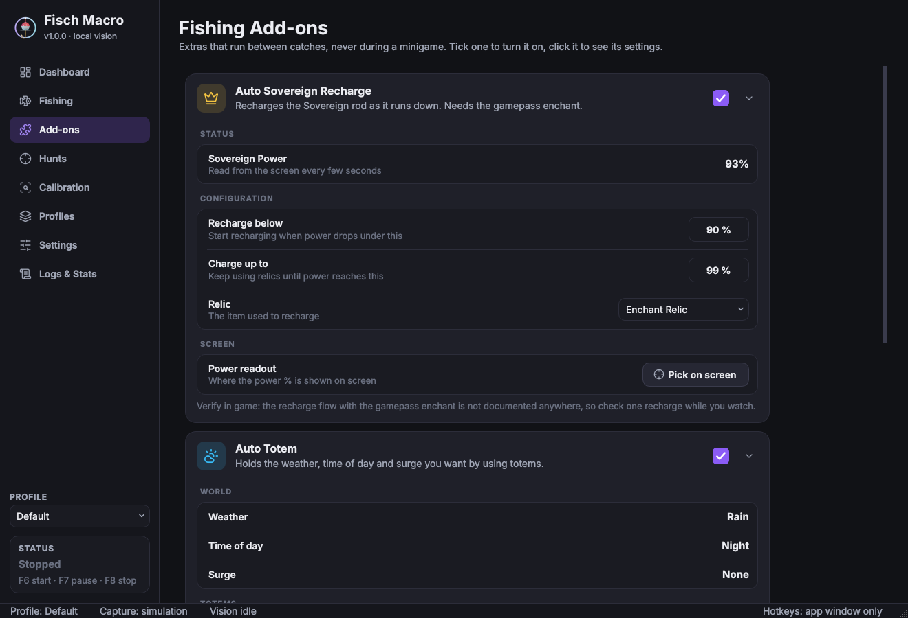
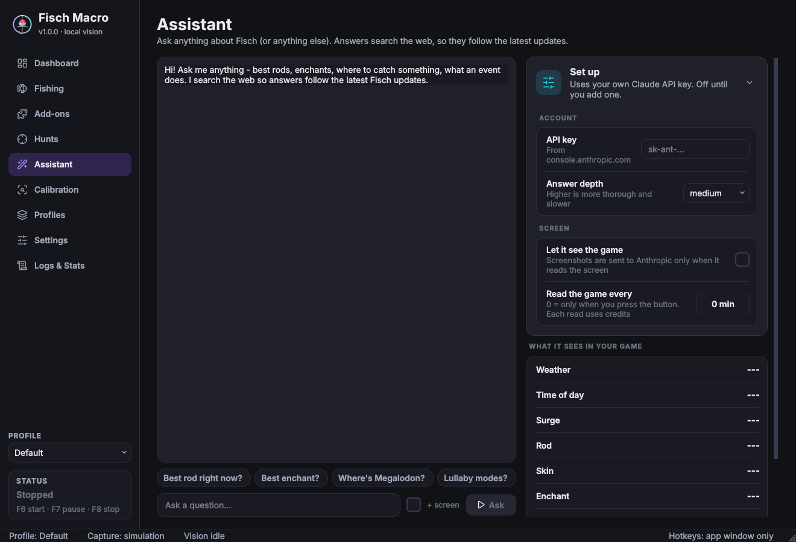
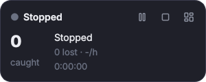
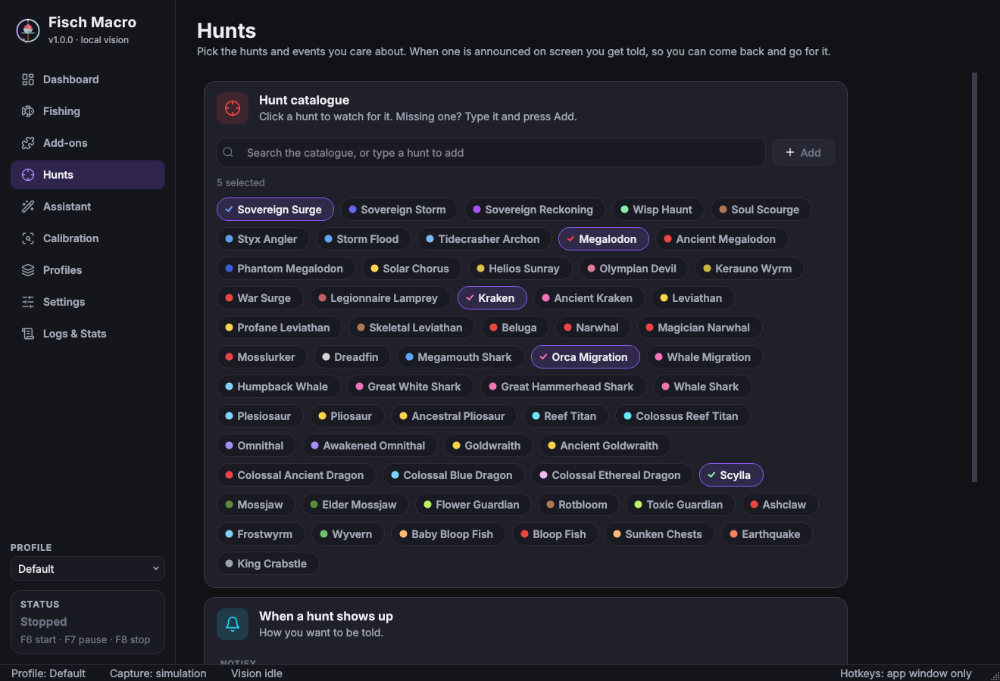
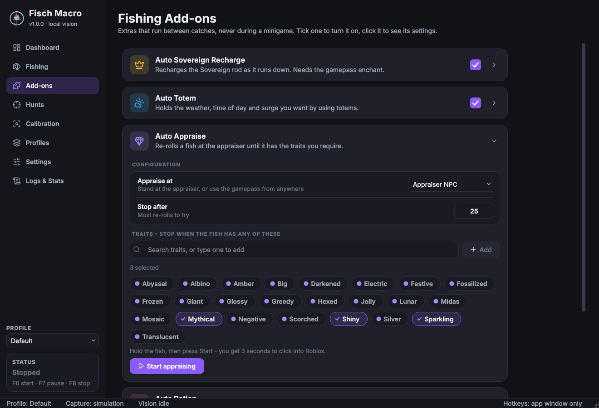
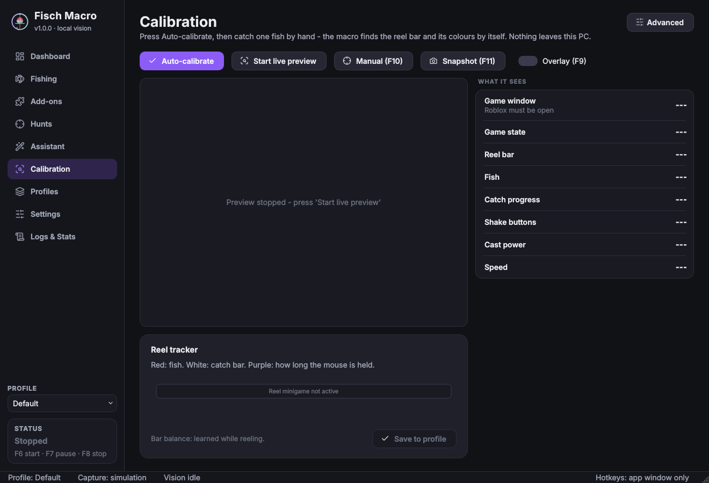
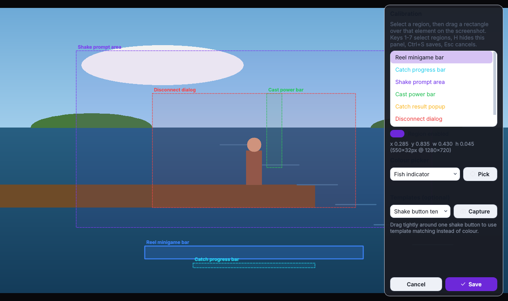

# Fisch Macro

A Windows desktop app that automates the fishing loop in **Roblox Fisch** using screen capture and computer
vision. It watches the game, recognises what is on screen (cast power bar, shake prompts, the reel minigame,
catch results, disconnect dialogs) and sends normal mouse/keyboard input through a finite-state machine and a
feedback controller.



| **Fishing** (live status, every rod or Automatic, Lullaby mode) | **Add-ons** (Sovereign, Totem, Appraise, Potion, Astral) |
|---|---|
|  |  |
| **Assistant** (ask anything, reads your game) | **Mini window** while fishing |
|  |  |
| **Hunts** (pick from the catalogue, or type one to add) | **Auto Appraise** (stop on the traits you pick) |
|  |  |
| **Calibration** (auto-calibrate, live preview) | **Manual calibration tool** |
|  |  |

> **Account risk.** Third-party automation can break Roblox's Terms of Use or Fisch's rules and may get your
> account restricted. Fisch Macro does **not** read game memory, inject code or bypass anti-cheat. It only
> looks at the screen and sends ordinary input. That does not make it allowed. Use it at your own risk.

---

## Contents

- [Features](#features)
- [Fishing, add-ons and hunts](#fishing-add-ons-and-hunts)
- [Install and launch](#install-and-launch)
- [First-run setup](#first-run-setup)
- [Testing in Roblox Fisch](#testing-in-roblox-fisch)
- [Tuning](#tuning)
- [Hotkeys](#hotkeys)
- [Troubleshooting](#troubleshooting)
- [Development](#development)
- [What is verified and what is not](#what-is-verified-and-what-is-not)
- [Privacy and safety](#privacy-and-safety)

## Features

**Auto-calibration (no manual setup needed)**
- **Auto-calibrate** (*Computer Vision* page, or the dashboard checklist): fish once and the app finds the reel
  bar, progress bar and cast power bar by itself from on-screen motion, then samples the bar, fish and progress
  colours.
- **Auto-adapt** (on by default): when a rod or skin change makes the minigame unrecognisable, the app finds and
  re-samples it during that same minigame, checks the result with the real detectors before using it, and
  saves it. In the simulator, 39 of 40 random rod/skin layouts calibrated fully automatically, and a profile
  with the wrong colours caught 2 of 2 fish after adapting (0 of 2 without it).
- Manual calibration (F10) is still there for fine control: drag rectangles, pick colours with a magnifier,
  capture templates.

**Computer vision (local, configurable)**
- Calibrated screen regions, stored in coordinates relative to the Roblox client area, so they survive window
  moves, different resolutions and DPI scaling (the app is per-monitor DPI aware).
- Detectors:
  - **Reel minigame**: fish indicator and catch-bar boundaries, from per-column colour projections.
  - **Catch progress**: fill level of the progress bar.
  - **Shake prompts**: colour blobs with area, aspect and solidity filters. Shake-coloured background that was
    already visible before the bite is ignored. Optional multi-scale template matching.
  - **Cast power bar**: fill level, for "perfect" casts.
  - **Disconnect / error dialogs**: heuristic, marked experimental.
  - **Catch popup**: optional template.
- Adjustable colours, tolerances and confidence thresholds. A colour picker with a magnifier samples colours
  straight from the game.
- Live preview with annotated detections, FPS and timing, plus a reel-tracker graph and a click-through debug
  overlay. On Windows 10 2004+ the overlay excludes itself from capture, so it never confuses the detectors.
- Only the regions the current state needs are captured. Full frames are grabbed only for periodic disconnect
  checks and the preview.

**Automation**
- Finite-state machine: `IDLE → CASTING → WAITING_FOR_BITE → SHAKE → REELING → CATCH_CONFIRMED → CASTING`, plus
  `RECOVERY` and `ERROR`. Transitions are validated and every state has timeouts.
- **Casting**: "perfect" (release when the power bar is full, or just after its peak), "timed", or "normal"
  (a short casual cast right after each catch). Timing has a little random jitter so it isn't machine-regular.
  Perfect mode falls back to the timed hold when the power bar is not seen.
- **Shake**: in click mode, each target must be seen in N frames in a row and has a re-click cooldown. In
  navigation mode, Roblox UI-navigation keys are used instead.
- **Reel solver**: PD controller with velocity feed-forward and look-ahead prediction. Gains are normalised by
  bar width. Sigma-delta conversion turns the controller output into hold/release decisions, with edge rules
  and safety limits (maximum continuous hold, release on low confidence or lost fish).
- **Precision tracking** (for tryhard and low-resilience rods): learns the bar physics while you reel (push,
  fall and drag), then every frame simulates the next 0.4 s for all 16 hold/release patterns and picks the one
  that keeps the fish closest to the bar centre. That's model-predictive control. In the simulator:
  - lopsided rod with a small bar: 14/20 catches vs 2/17 with standard tracking;
  - low resilience: 19/20 vs 17/20;
  - normal rods: no regression.
- **Faster reaction**: the reel minigame is captured at its own rate (90 FPS by default) and only the regions it
  needs are grabbed.
- **Hover-duty auto-tune** (on by default): learns each rod's "hover duty", the hold fraction that keeps the bar
  still, from how the bar actually responds while you reel. It regresses bar acceleration on hold state, with
  forgetting so it adapts to the current rod. You can save the learned value to the profile from the Computer
  Vision page. In the simulator it lands within about 0.02 of the true value. On strongly lopsided rods it
  raised catches from 10/16 to 14/16 and from 10/16 to 12/16.
- **Outcome detection**: success, failure or *unconfirmed*, decided from the final progress value or a catch
  template. The app never claims a catch it couldn't see.
- **Recovery**: on timeout it releases input, optionally clicks to reel the line in and re-equips, then
  re-syncs to whatever is on screen. Too many recoveries in a row stop automation with an error.

**Safety**
- Automation **never starts on launch**.
- The emergency stop (F8) releases every held button and key immediately, straight from the hotkey thread,
  and turns on an input kill switch.
- Inputs pause automatically when Roblox loses focus, the window disappears or capture fails. The app stops
  with a clear error if this lasts too long.
- If the game state is unknown, the app releases input and waits. It never clicks blindly.

**Modules** (extensible; they can only send input *between* catches)
- Session limits (stop after N catches, N minutes, or N failures in a row).
- Timed actions (e.g. eat food or use a buff item every X minutes).
- Totem / item reminder, with an optional activation routine (*experimental*).
- Auto reconnect (*experimental*).

**App**
- Pages: Dashboard, Fishing, Add-ons, Hunts, Calibration, Profiles, Settings (with Hotkeys), Logs & Stats.
  Every number and colour is still there for fine tuning, behind the *Advanced* buttons.
- A **"Get ready for Fisch" checklist** on the dashboard tracks real setup progress: risk notice, game window
  found, reel calibrated, colours sampled, minigame seen in the live preview, first live catch. Each step has a
  button that jumps to the right place. Hide it once you're set up; it can be shown again from Settings.
- **Six themes**: Midnight Violet, Deep Ocean, Abyss Emerald, Coral Reef, Arctic Light and High Contrast.
- Three text sizes (Compact, Comfortable, Large) and a reduce-motion option.
- Original 3D artwork rendered with Blender from a script in the repo (`packaging/blender/render_assets.py`).
- Profiles: create, edit, duplicate, rename, delete, import and export, with a quick switcher in the sidebar.
- Session statistics in SQLite, a cycle timeline chart, CSV export, and a diagnostics ZIP export.
- Notifications: toasts, tray icon with quick controls, desktop notifications, an error sound, and catch
  milestones.
- A **simulation mode** that runs the whole loop against a built-in model of the game, with no real input.

## Fishing, add-ons and hunts

### Fishing page

Live **Status** (phase, progress, input, rod) and **Statistics** (caught, lost, success rate, per hour), then
plain dropdowns: **Rod** (*Automatic* reads it from the screen, or pick from all ~200 rods - type to search),
**Tracking method** (Standard / Precision for tryhard and low-resilience rods), **Casting mode** (Normal /
Perfect / Timed), **Shake mode**, the **Rod minigame** and the **Lullaby mode**.

**Any rod skin, no calibration.** The fish is found by its shape (a thin line that stands out from the
track), the catch bar and the progress bar by contrast with the empty track. Colours of the previous rod or
skin are never reused: a new rod starts from clean colours and the tracker relearns the track's look on its
own. In the simulator, 40 random skins (ornament frames, gradient tracks, see-through bars, recoloured fish
markers, 720p and 1080p, with and without noise) went from 0 of 15 catches to **80 of 80** without any
calibration. Auto-calibrate still exists for odd setups.

**Rod minigames.**

| Rod | What the app does | Status |
|---|---|---|
| **Lullaby** | Pick the **Lullaby mode** (Resistant Composition, Quickening Symphony, Strengthening Melody, Fortuitous Harmony, Prismatic Sinfonia, Serene Hymn, or *Keep current*); between catches the app presses Q until that mode's name is on screen. Every click off a lit section costs 5% progress, so by default the bar is left alone and only the pendulum is played: one click per lit section, aimed at where the pendulum will be when the click lands. That delay (your PC + Roblox) is **measured from the hits themselves**, so it adapts to any PC. Reads any skin (pendulum by shape, lit sections by brightness). | Rules from the official Fisch wiki. Simulator: 20-100 ms input delays all learned; e.g. 154 hits / 17 misses at 40 ms. |
| **Stellarwave Melody** | Finds the star sign you must match and clicks the matching one on the wheel. | Verified in the simulator. Calibrate the two regions in game. |
| **Halibut Harpoon** | Clicks marked targets. | Experimental. |
| **Pinion's Aria, Migurod, other tryhard rods** | Precision tracking with a larger safety margin. | Same tracker as above. |

### Add-ons page

Each add-on is a card: tick it to turn it on, click it to see its settings. They act only between catches.

| Add-on | What it does |
|---|---|
| **Auto Sovereign Recharge** | Reads the rod's *Sovereign Power* % from the screen. Below *Recharge below* (90) it uses relics until *Charge up to* (99). Needs the gamepass enchant. **Verify in game.** |
| **Auto Totem** | Reads the **World** (weather, time of day, surge) and uses the matching totem when it differs from what you picked: the weather totem to hold, a surge totem (Shiny / Sparkling / Mutation), or the Sundial Totem for Day / Night. Waits between uses. |
| **Auto Appraise** | Re-rolls the held fish at the Appraiser NPC or with the gamepass until it has any trait you ticked (24 traits, or type your own), up to *Stop after* tries. |
| **Auto Potion / Astral Activator** | Uses the item on a timer. |
| **Items & inventory** | Which hotbar slot holds what. Anything else is found by typing its name in the inventory search. |

### Hunts page

Click hunts in the catalogue (Megalodon, Kraken, Sovereign Surge, Scylla, ... 60 in total) or type one and
press **Add**. When a ticked hunt is announced on screen (read with offline OCR) you get a Discord message
(if a webhook is set in *Settings*), a pop-up, and optionally a pause so you can come back and go for it.

**Automatic rod and skin profiles.** With *Detect rod automatically* on, the app reads the equipped rod. A new
rod gets its own profile with the matching preset; a known rod switches back to its profile. A new skin on an
already-calibrated rod gets a separate *"(skin N)"* profile. Switches only happen between catches.

### Technology choices

| Concern | Choice | Why |
|---|---|---|
| UI | PySide6 (Qt 6) | Native, fast, themable, high-DPI aware, LGPL |
| Vision | OpenCV + NumPy | Fast colour masks, connected components, template matching |
| Capture | MSS | Small, fast GDI capture of a sub-rectangle; no admin rights |
| Input | Win32 `SendInput` with hardware scan codes | Roblox reads keys by scan code; no drivers, no injection |
| Global hotkeys | pynput | Low-level keyboard hook |
| Storage | JSON (settings, profiles), SQLite (statistics) | Human-editable config, robust stats |
| Text recognition | RapidOCR (ONNX Runtime) | Offline OCR bundled with the app; reads hunts, weather and rod names |
| Packaging | PyInstaller (one-folder) | Standalone `.exe`, quick start-up |

## Install and launch

### Option A: packaged app (no Python needed)

1. Get `FischMacro-windows` from the GitHub Actions run of the **Fisch Macro (Windows build)** workflow, or
   build it yourself (Option C).
2. Unzip it anywhere, for example `D:\MACROS\FischMacro`, and run `FischMacro.exe`. No installer and no
   administrator rights are needed.
3. **The packaged app is portable:** settings, profiles, logs, statistics and snapshots are kept in a `data`
   folder next to `FischMacro.exe`, so nothing is written to drive C. Move or back up the whole folder to move
   everything. (Only if that folder is read-only does it fall back to `%APPDATA%\FischMacro`. Set the
   `FISCHMACRO_HOME` environment variable to pick any other folder.)

### Option B: run from source (development)

```powershell
cd projects\fisch-macro
py -3.12 -m venv .venv
.venv\Scripts\activate
pip install -r requirements.txt
pip install --no-deps rapidocr-onnxruntime==1.2.3   # OCR (no-deps: keeps the headless OpenCV build)
python run.py               # normal mode
python run.py --simulation  # built-in simulated game, no real input
```

### Option C: build the executable

```powershell
cd projects\fisch-macro
packaging\build_windows.bat
```

This creates a virtualenv, installs dependencies, runs the tests, builds `dist\FischMacro\FischMacro.exe` with
PyInstaller, smoke-tests it, and runs `FischMacro.exe --self-test`, which checks that OCR and the vision engine
work inside the bundle. The bundle is about 300–430 MB, mostly OpenCV, Qt and the OCR runtime.

Settings, profiles, logs and statistics are stored in `%APPDATA%\FischMacro`. They persist between launches
and between versions.

## First-run setup

The dashboard checklist walks you through these and ticks them off by itself: risk notice, real game (not the
test mode), Roblox window found, **Windows display scale at 100%** (higher scaling can make the bar drift),
rod picked (or Automatic), first catch. **No calibration is needed** for the reel.

1. **Read and accept the risk notice** on first launch.
2. **Try simulation mode first** (optional but recommended). In *Settings → Screen capture*, set *Capture
   source* to `simulation`, then press **Start** on the Dashboard. You will see casting, shaking and the reel
   solver running against the built-in test game. Switch back to `window` afterwards.
3. **Prepare Roblox.** Play in **windowed or borderless** mode. Equip your rod. Leave the UI scale at its
   default for your first calibration.
4. **Check the window title.** *Settings → Screen capture → Game window title* should be `Roblox`.
5. *(Optional)* **Auto-calibrate** (*Calibration → Auto-calibrate*). Only needed if the fish or bar is not
   tracked on your setup. Cast and reel one fish manually; the app finds the bars and colours by itself.

   **Manual calibration** (*Computer Vision → Manual calibration* or **F10**). A frozen screenshot appears over
   the game. For each region, select it in the panel (or press 1–9) and drag a rectangle:
   - **Reel minigame bar**: start a minigame, then press F10 while it is visible. Draw tightly around the
     horizontal bar.
   - **Catch progress bar**: the progress bar under it.
   - **Shake prompt area**: the area where shake buttons can appear.
   - **Cast power bar**: hold to cast, then press F10 while the power bar shows.
   - **Disconnect dialog / Reconnect button**: only needed for auto-reconnect.

   Then use the **colour picker** to sample the fish indicator, catch bar, progress fill, shake button and cast
   fill. If colour detection of shake buttons is unreliable, use **Templates → Capture** and drag tightly
   around one shake button. Press **Save**.
6. **Verify detection.** Open *Computer Vision* and press **Start live preview**. Fish in the game manually
   and check that each element is outlined and the *Detections* panel shows high confidence. Press **F11** to
   save a diagnostic snapshot when something looks wrong.
7. **Start automation** with F6 while Roblox is focused. Press F8 at any time to stop.

## Testing in Roblox Fisch

1. Launch Roblox Fisch windowed, stand at the water with a rod equipped.
2. Launch Fisch Macro, check *Settings → Capture source* = `window`.
3. Calibrate (step 5 above) and confirm detection with the live preview (step 6).
4. Enable the **Session limits** module (*Fishing → Advanced → Modules*) with *Stop after 5 catches* for the first test.
5. Click into Roblox and press **F6**. Watch the Dashboard (or turn on the debug overlay with F9).
6. If the reel bar overshoots or lags behind the fish, tune the reel controller (below) and try again.
7. Check *Logs & Statistics*. Catches should be *confirmed*. Many *unconfirmed* catches mean the progress bar
   region or colour needs calibrating.

## Tuning

**Reel controller** (*Fishing → Advanced → Reeling*, saved per profile, so make one profile per rod):

| Symptom | Change |
|---|---|
| Bar drifts left even when the fish is centred | let **auto-tune** learn the hover duty (or raise **Hover duty**) |
| Bar drifts right | let **auto-tune** learn the hover duty (or lower **Hover duty**) |
| Bar is too slow to follow a fast fish | raise **Kp** or **feed-forward** |
| Bar overshoots and oscillates | raise **Kd**, lower **Kp** |
| Jittery input on a noisy detection | raise **Velocity smoothing** |
| Tiny bar / fish escapes on tryhard rods | switch **Tracking mode** to **precision** |

**Lullaby**: if clicks land just after the lit section, raise *Input lead* (ms); if they land early, lower it.
Use *Mode key presses per catch* to choose the mode.

**Shake**: if buttons are missed, widen *Shake tolerance* or use a template. If clicks land on scenery, lower the
tolerance, raise *Frames before clicking*, or use navigation mode.

**Performance**: *Settings → Detection performance*. 30–60 FPS is plenty. Region-only capture keeps CPU usage
low (typically a few ms per frame).

## Hotkeys

| Default | Action |
|---|---|
| F6 | Start automation (or resume) |
| F7 | Pause / resume (releases all input) |
| F8 | **Emergency stop**: releases every held input immediately |
| F9 | Toggle debug overlay |
| F10 | Open / close calibration |
| F11 | Diagnostic snapshot |
| Ctrl+1…9 | Switch pages (while the app is focused) |

Change them in *Hotkeys*: click a shortcut, then press the new key. The page warns about duplicates and about
keys the automation itself presses in-game, such as the rod slot key. Holding a key fires its action only
once.

## Troubleshooting

| Problem | Fix |
|---|---|
| "Game window not found" | Roblox must be open and not minimised. Check *Game window title*. Use *monitor* capture mode as a fallback. |
| Inputs pause with "Roblox is not focused" | Click into Roblox. Inputs are intentionally paused while you use other windows. |
| Hotkeys do nothing in game | The status bar must say *Global hotkeys on*. Security software can block keyboard hooks. Run Roblox and the app at the same privilege level. |
| Clicks do not register in Roblox | Keep *Nudge cursor before clicks* on. Raise *Click hold* to 40–60 ms. |
| Regions are off after changing resolution or UI scale | Re-calibrate. Regions are relative, but Roblox's UI does not scale linearly with every setting. |
| Casts but never reels | Open *Calibration*, press *Auto-calibrate* and catch one fish by hand. "Reel bar: Seen (bar unclear)" means the fish is followed but the bar colour is off - auto-calibrate fixes that. |
| Keys (shake navigation, hotbar) do nothing | Keep *Input method* on *Scan codes* (Fishing → Input). The navigation key must match Roblox's *UI Navigation Toggle*. |
| Hunts / weather / power never read | Re-pick the area with *Pick on screen* so the box tightly covers the text. |
| Rod profile switches to the wrong rod | Edit *Rod name* in each profile to the exact name OCR reads, or turn off *Automatic rod profiles*. |
| Many "unconfirmed" outcomes | Calibrate the progress bar region and colour, or add a catch-popup template. |
| Too many recoveries / error stop | Save an F11 snapshot and compare *annotated.png* with the game. Usually a colour or region needs adjusting. |
| Something else | *Logs & Statistics → Export diagnostics (ZIP)*. It contains logs, settings, profile and recent snapshots. It stays on your PC; share it only if you choose to. |

## Development

```bash
pip install -r requirements.txt
python -m pytest -q                                   # full test suite
python -m fischmacro.simulation.harness --cycles 20   # closed-loop simulation benchmark
python tests/make_fixtures.py                         # regenerate synthetic screenshot fixtures
python packaging/blender/render_assets.py             # re-render artwork (pip install bpy)
python packaging/make_icon.py                         # rebuild the .ico (needs Pillow)
```

### Project structure

```
fischmacro/
  app/           entry point (main.py) and shared app context
  ui/            main window, pages/, theme + 6 palettes, calibration tool, debug overlay, tray, toasts
  vision/        capture, Win32 window lookup, detectors, rod minigame detectors, auto-calibration, OCR
  automation/    FSM, reel controller (PD + learned model + MPC), rod minigame solvers, routines, watchers,
                 threaded runtime engine, modules/
  input/         input controller with kill switch, global hotkey manager
  profiles/      typed config schema with UI metadata, profile + settings persistence
  diagnostics/   logging (text + JSON lines), SQLite statistics, snapshots and diagnostic export
  simulation/    simulated Fisch-like game and the closed-loop harness
tests/           unit, integration, end-to-end simulation and offscreen UI tests; fixtures/
assets/          Blender-rendered logo, icon and banner
docs/screenshots README screenshots (rendered from the real app in simulation mode)
packaging/       PyInstaller spec, Windows build script, Blender render script, icon script
```

### Threads

- **Capture thread**: grabs only the regions needed into a bounded queue (size 2). Stale frames are dropped.
- **Vision thread**: runs detection, then the FSM, then sends input.
- **Hotkey listener thread**: the emergency stop acts here directly; other actions are queued to the UI thread.
- **UI thread**: polls an immutable snapshot about 15 times a second. Workers never touch widgets.

### Extending: adding a module

```python
from fischmacro.automation.modules.base import GameModule, ModuleField, register

@register
class AutoSell(GameModule):
    id = "auto_sell"
    name = "Auto sell"
    description = "Sell fish every N catches."
    experimental = True
    fields = [ModuleField("every", "Every N catches", "int", 50, 1, 1000)]

    def on_cycle_complete(self, ctx, outcome):
        self.state["n"] = self.state.get("n", 0) + (outcome == "success")

    def at_safe_point(self, ctx):          # only called between catches
        if self.state.get("n", 0) >= int(self.get("every")):
            ...                            # ctx.press_key / ctx.click_client / ctx.sleep
            self.state["n"] = 0
```

Import it in `fischmacro/automation/modules/__init__.py`. Its settings form appears automatically on the
Automation page.

## What is verified and what is not

Verified in this repository (automated tests, run on Linux and in the Windows CI workflow):
- State-machine transitions, timeouts, recovery, error stops, and that input is never sent on unknown frames.
- Detectors against saved synthetic screenshots at 640×360, 1280×720, 1600×900 and 1920×1080, with noise
  and JPEG artefacts, plus template matching across scales.
- Reel controller maths, and closed-loop catching in the simulator: 5/5 cycles at three difficulties,
  1080p with noise, 20 FPS, and navigation mode. Hover-duty auto-tune learns an asymmetric rod correctly.
- Profile persistence, hotkey parsing / auto-repeat / conflicts, the input kill switch, emergency stop,
  behaviour when Roblox is closed or capture fails, and focus loss.
- Auto-calibration on 40 random rod/skin layouts (moving and parked bar), result validation, and live
  adaptation to a new skin mid-session.
- Precision tracking beats standard tracking on lopsided small-bar rods. The learned bar model matches the
  simulator's true physics within about 10%.
- Rod minigames (Lullaby, Stellarwave, targets) solved in the simulator *while still catching every fish*.
- Any rod skin without calibration: 80/80 catches on 40 random simulated skins; the real Plaguereaver
  screenshot is part of the tests. Lullaby reads random skins and learns 20-100 ms input delays.
- Routines: hotbar and inventory-search item use, OCR button clicks, repeat-until-mutation, scheduling, and a
  routine running between catches during live automation.
- Watchers: OCR hunt detection with cooldowns, rod-name changes, fuzzy matching of OCR typos, Discord payloads
  (against a local test server), automatic rod and skin profiles.
- The UI builds offscreen in every theme and text size, calibration saves, and buttons drive the engine.
- The PyInstaller build starts and runs in simulation mode, and `--self-test` confirms OCR works inside the
  bundle (Linux build verified locally; the Windows `.exe` is built and self-tested by the CI workflow).

**Needs live testing in Roblox Fisch** (it can't be tested without the real game):
- Region positions are relative estimates (the reel area is found within them by shape); unusual layouts may
  still need Auto-calibrate.
- How the Lullaby UI shows a hit (the delay is learned from the lit sections changing after a hit).
- Reel-controller gains for specific rods. The simulator models the bar physics, not Fisch's exact values.
- The appearance of shake buttons and their colour. Template mode is the most robust option.
- Perfect-cast detection, disconnect detection and auto reconnect (marked *experimental* in the UI).
- Behaviour after Fisch UI updates. Auto-adapt handles colour changes; re-run Auto-calibrate after layout changes.
- Rod minigames: the Lullaby lead time, Stellarwave region and sign colour, and whether Halibut Harpoon targets
  need clicking at all.
- Add-ons: the Sovereign gamepass recharge flow, the appraise button names, the inventory key, and where
  the power and world readouts appear on screen. They are marked *verify in game*.

## AI assistant (optional)

The *Assistant* page uses Claude (Anthropic) with live web search, so answers follow the latest Fisch updates:
best rods, enchants, where to catch something, what an event does - or anything else. It can also **read
your game screen** (weather, time of day, surge, events and hunts, rod, skin, enchant) when you press *Read my
game now* or on a timer; the result feeds Auto Totem, rod profiles and hunt alerts.

- It is **off until you paste your own API key** (from console.anthropic.com) in *Assistant → Set up*.
  Usage is billed to that key.
- Screenshots are sent to Anthropic **only** if you tick *Let it see the game*, and only when it reads the
  screen or you attach one to a question. Nothing is sent otherwise.

## Mini window

With *Fishing → Shrink to a small window* on (default), pressing Start turns the app into a small card that
stays on top: status, fish caught and lost, catches per hour, time, plus pause / stop / open-full-window
buttons. Drag it anywhere; double-click to expand. It returns to the full window when fishing stops.

## Privacy and safety

- All processing is local, and the packaged app keeps all its files in its own folder (see Install).
  Screenshots stay in memory unless you save a diagnostic snapshot, or you turn on
  the optional AI assistant's screen reading (see above).
- No credentials, cookies, tokens or personal data are read. The app downloads or executes no code at runtime.
- The only network traffic is optional: Discord alerts go to the webhook URL you paste (screenshots only if you
  enable that), and the AI assistant talks to Anthropic only once you add your API key. With neither set,
  nothing leaves your PC. OCR runs offline.
- No administrator rights, drivers, memory access, process injection or anti-cheat evasion.
- Not affiliated with Roblox Corporation or the developers of Fisch. Product inspiration was taken from the
  general concept of existing macro tools; all code and artwork here is original.
