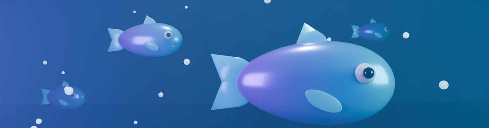

# Fisch Macro

A Windows desktop app that automates the fishing loop in **Roblox Fisch** using screen capture and computer
vision. It watches the game, recognises what is on screen (cast power bar, shake prompts, the reel minigame,
catch results, disconnect dialogs) and sends normal mouse/keyboard input through a finite-state machine and a
feedback controller.



> **Account risk.** Third-party automation can break Roblox's Terms of Use or Fisch's rules and may get your
> account restricted. Fisch Macro does **not** read game memory, inject code or bypass anti-cheat. It only
> looks at the screen and sends ordinary input. That does not make it allowed. Use it at your own risk.

---

## Contents

- [Features](#features)
- [Install and launch](#install-and-launch)
- [First-run setup](#first-run-setup)
- [Testing in Roblox Fisch](#testing-in-roblox-fisch)
- [Tuning](#tuning)
- [Hotkeys](#hotkeys)
- [Troubleshooting](#troubleshooting)
- [Development](#development)
- [What is verified and what is not](#what-is-verified-and-what-is-not)
- [Privacy and safety](#privacy-and-safety)

## Features

**Computer vision (local, configurable)**
- Calibrated screen regions, stored in coordinates relative to the Roblox client area, so they survive window
  moves, different resolutions and DPI scaling (the app is per-monitor DPI aware).
- Detectors:
  - **Reel minigame**: fish indicator and catch-bar boundaries, from per-column colour projections.
  - **Catch progress**: fill level of the progress bar.
  - **Shake prompts**: colour blobs with area, aspect and solidity filters. Shake-coloured background that was
    already visible before the bite is ignored. Optional multi-scale template matching.
  - **Cast power bar**: fill level, for "perfect" casts.
  - **Disconnect / error dialogs**: heuristic, marked experimental.
  - **Catch popup**: optional template.
- Adjustable colours, tolerances and confidence thresholds. A colour picker with a magnifier samples colours
  straight from the game.
- Live preview with annotated detections, FPS and timing, plus a reel-tracker graph and a click-through debug
  overlay. On Windows 10 2004+ the overlay excludes itself from capture, so it never confuses the detectors.
- Only the regions the current state needs are captured. Full frames are grabbed only for periodic disconnect
  checks and the preview.

**Automation**
- Finite-state machine: `IDLE → CASTING → WAITING_FOR_BITE → SHAKE → REELING → CATCH_CONFIRMED → CASTING`, plus
  `RECOVERY` and `ERROR`. Transitions are validated and every state has timeouts.
- **Casting**: either "perfect" (release when the power bar is full, or just after its peak) or "timed".
  Falls back to the timed hold when the power bar is not seen.
- **Shake**: in click mode, each target must be seen in N frames in a row and has a re-click cooldown. In
  navigation mode, Roblox UI-navigation keys are used instead.
- **Reel solver**: PD controller with velocity feed-forward and look-ahead prediction. Gains are normalised by
  bar width. Sigma-delta conversion turns the controller output into hold/release decisions, with edge rules
  and safety limits (maximum continuous hold, release on low confidence or lost fish).
- **Outcome detection**: success, failure or *unconfirmed*, decided from the final progress value or a catch
  template. The app never claims a catch it couldn't see.
- **Recovery**: on timeout it releases input, optionally clicks to reel the line in and re-equips, then
  re-syncs to whatever is on screen. Too many recoveries in a row stop automation with an error.

**Safety**
- Automation **never starts on launch**.
- The emergency stop (F8) releases every held button and key immediately, straight from the hotkey thread,
  and turns on an input kill switch.
- Inputs pause automatically when Roblox loses focus, the window disappears or capture fails. The app stops
  with a clear error if this lasts too long.
- If the game state is unknown, the app releases input and waits. It never clicks blindly.

**Modules** (extensible; they can only send input *between* catches)
- Session limits (stop after N catches, N minutes, or N failures in a row).
- Timed actions (e.g. eat food or use a buff item every X minutes).
- Totem / item reminder, with an optional activation routine (*experimental*).
- Auto reconnect (*experimental*).

**App**
- Pages: Dashboard, Automation, Computer Vision, Profiles, Hotkeys, Settings, Logs & Statistics.
- **Six themes**: Midnight Violet, Deep Ocean, Abyss Emerald, Coral Reef, Arctic Light and High Contrast.
- Three text sizes (Compact, Comfortable, Large) and a reduce-motion option.
- Original 3D artwork rendered with Blender from a script in the repo (`packaging/blender/render_assets.py`).
- Profiles: create, edit, duplicate, rename, delete, import and export, with a quick switcher in the sidebar.
- Session statistics in SQLite, a cycle timeline chart, CSV export, and a diagnostics ZIP export.
- Notifications: toasts, tray icon with quick controls, desktop notifications, an error sound, and catch
  milestones.
- A **simulation mode** that runs the whole loop against a built-in model of the game, with no real input.

### Technology choices

| Concern | Choice | Why |
|---|---|---|
| UI | PySide6 (Qt 6) | Native, fast, themable, high-DPI aware, LGPL |
| Vision | OpenCV + NumPy | Fast colour masks, connected components, template matching |
| Capture | MSS | Small, fast GDI capture of a sub-rectangle; no admin rights |
| Input + global hotkeys | pynput | Standard `SendInput` and low-level keyboard hook; no drivers |
| Storage | JSON (settings, profiles), SQLite (statistics) | Human-editable config, robust stats |
| Packaging | PyInstaller (one-folder) | Standalone `.exe`, quick start-up |

## Install and launch

### Option A: packaged app (no Python needed)

1. Get `FischMacro-windows` from the GitHub Actions run of the **Fisch Macro (Windows build)** workflow, or
   build it yourself (Option C).
2. Unzip it anywhere and run `FischMacro.exe`. No installer and no administrator rights are needed.

### Option B: run from source (development)

```powershell
cd projects\fisch-macro
py -3.12 -m venv .venv
.venv\Scripts\activate
pip install -r requirements.txt
python run.py               # normal mode
python run.py --simulation  # built-in simulated game, no real input
```

### Option C: build the executable

```powershell
cd projects\fisch-macro
packaging\build_windows.bat
```

This creates a virtualenv, installs dependencies, runs the tests, builds `dist\FischMacro\FischMacro.exe` with
PyInstaller and smoke-tests it. The bundle is about 250–370 MB, mostly OpenCV and Qt.

Settings, profiles, logs and statistics are stored in `%APPDATA%\FischMacro`. They persist between launches
and between versions.

## First-run setup

1. **Read and accept the risk notice** on first launch.
2. **Try simulation mode first** (optional but recommended). In *Settings → Screen capture*, set *Capture
   source* to `simulation`, then press **Start** on the Dashboard. You will see casting, shaking and the reel
   solver running against the built-in test game. Switch back to `window` afterwards.
3. **Prepare Roblox.** Play in **windowed or borderless** mode. Equip your rod. Leave the UI scale at its
   default for your first calibration.
4. **Check the window title.** *Settings → Screen capture → Game window title* should be `Roblox`.
5. **Calibrate** (*Computer Vision → Calibrate regions* or **F10**). A frozen screenshot appears over the game.
   For each region, select it in the panel (or press 1–7) and drag a rectangle:
   - **Reel minigame bar**: start a minigame, then press F10 while it is visible. Draw tightly around the
     horizontal bar.
   - **Catch progress bar**: the progress bar under it.
   - **Shake prompt area**: the area where shake buttons can appear.
   - **Cast power bar**: hold to cast, then press F10 while the power bar shows.
   - **Disconnect dialog / Reconnect button**: only needed for auto-reconnect.

   Then use the **colour picker** to sample the fish indicator, catch bar, progress fill, shake button and cast
   fill. If colour detection of shake buttons is unreliable, use **Templates → Capture** and drag tightly
   around one shake button. Press **Save**.
6. **Verify detection.** Open *Computer Vision* and press **Start live preview**. Fish in the game manually
   and check that each element is outlined and the *Detections* panel shows high confidence. Press **F11** to
   save a diagnostic snapshot when something looks wrong.
7. **Start automation** with F6 while Roblox is focused. Press F8 at any time to stop.

## Testing in Roblox Fisch

1. Launch Roblox Fisch windowed, stand at the water with a rod equipped.
2. Launch Fisch Macro, check *Settings → Capture source* = `window`.
3. Calibrate (step 5 above) and confirm detection with the live preview (step 6).
4. Enable the **Session limits** module (*Automation → Modules*) with *Stop after 5 catches* for the first test.
5. Click into Roblox and press **F6**. Watch the Dashboard (or turn on the debug overlay with F9).
6. If the reel bar overshoots or lags behind the fish, tune the reel controller (below) and try again.
7. Check *Logs & Statistics*. Catches should be *confirmed*. Many *unconfirmed* catches mean the progress bar
   region or colour needs calibrating.

## Tuning

**Reel controller** (*Automation → Reeling*, saved per profile, so make one profile per rod):

| Symptom | Change |
|---|---|
| Bar drifts left even when the fish is centred | raise **Hover duty** |
| Bar drifts right | lower **Hover duty** |
| Bar is too slow to follow a fast fish | raise **Kp** or **feed-forward** |
| Bar overshoots and oscillates | raise **Kd**, lower **Kp** |
| Jittery input on a noisy detection | raise **Velocity smoothing** |

**Shake**: if buttons are missed, widen *Shake tolerance* or use a template. If clicks land on scenery, lower the
tolerance, raise *Frames before clicking*, or use navigation mode.

**Performance**: *Settings → Detection performance*. 30–60 FPS is plenty. Region-only capture keeps CPU usage
low (typically a few ms per frame).

## Hotkeys

| Default | Action |
|---|---|
| F6 | Start automation (or resume) |
| F7 | Pause / resume (releases all input) |
| F8 | **Emergency stop**: releases every held input immediately |
| F9 | Toggle debug overlay |
| F10 | Open / close calibration |
| F11 | Diagnostic snapshot |
| Ctrl+1…7 | Switch pages (while the app is focused) |

Change them in *Hotkeys*: click a shortcut, then press the new key. The page warns about duplicates and about
keys the automation itself presses in-game, such as the rod slot key. Holding a key fires its action only
once.

## Troubleshooting

| Problem | Fix |
|---|---|
| "Game window not found" | Roblox must be open and not minimised. Check *Game window title*. Use *monitor* capture mode as a fallback. |
| Inputs pause with "Roblox is not focused" | Click into Roblox. Inputs are intentionally paused while you use other windows. |
| Hotkeys do nothing in game | The status bar must say *Global hotkeys on*. Security software can block keyboard hooks. Run Roblox and the app at the same privilege level. |
| Clicks do not register in Roblox | Keep *Nudge cursor before clicks* on. Raise *Click hold* to 40–60 ms. |
| Regions are off after changing resolution or UI scale | Re-calibrate. Regions are relative, but Roblox's UI does not scale linearly with every setting. |
| Many "unconfirmed" outcomes | Calibrate the progress bar region and colour, or add a catch-popup template. |
| Too many recoveries / error stop | Save an F11 snapshot and compare *annotated.png* with the game. Usually a colour or region needs adjusting. |
| Something else | *Logs & Statistics → Export diagnostics (ZIP)*. It contains logs, settings, profile and recent snapshots. It stays on your PC; share it only if you choose to. |

## Development

```bash
pip install -r requirements.txt
python -m pytest -q                                   # full test suite
python -m fischmacro.simulation.harness --cycles 20   # closed-loop simulation benchmark
python tests/make_fixtures.py                         # regenerate synthetic screenshot fixtures
python packaging/blender/render_assets.py             # re-render artwork (pip install bpy)
python packaging/make_icon.py                         # rebuild the .ico (needs Pillow)
```

### Project structure

```
fischmacro/
  app/           entry point (main.py) and shared app context
  ui/            main window, pages/, theme + 6 palettes, calibration tool, debug overlay, tray, toasts
  vision/        capture (MSS / simulation / screenshot folder), Win32 window lookup, detectors, vision engine
  automation/    FSM (fsm.py), reel PD controller, threaded runtime engine, modules/
  input/         input controller with kill switch, global hotkey manager
  profiles/      typed config schema with UI metadata, profile + settings persistence
  diagnostics/   logging (text + JSON lines), SQLite statistics, snapshots and diagnostic export
  simulation/    simulated Fisch-like game and the closed-loop harness
tests/           unit, integration, end-to-end simulation and offscreen UI tests; fixtures/
assets/          Blender-rendered logo, icon and banner
packaging/       PyInstaller spec, Windows build script, Blender render script, icon script
```

### Threads

- **Capture thread**: grabs only the regions needed into a bounded queue (size 2). Stale frames are dropped.
- **Vision thread**: runs detection, then the FSM, then sends input.
- **Hotkey listener thread**: the emergency stop acts here directly; other actions are queued to the UI thread.
- **UI thread**: polls an immutable snapshot about 15 times a second. Workers never touch widgets.

### Extending: adding a module

```python
from fischmacro.automation.modules.base import GameModule, ModuleField, register

@register
class AutoSell(GameModule):
    id = "auto_sell"
    name = "Auto sell"
    description = "Sell fish every N catches."
    experimental = True
    fields = [ModuleField("every", "Every N catches", "int", 50, 1, 1000)]

    def on_cycle_complete(self, ctx, outcome):
        self.state["n"] = self.state.get("n", 0) + (outcome == "success")

    def at_safe_point(self, ctx):          # only called between catches
        if self.state.get("n", 0) >= int(self.get("every")):
            ...                            # ctx.press_key / ctx.click_client / ctx.sleep
            self.state["n"] = 0
```

Import it in `fischmacro/automation/modules/__init__.py`. Its settings form appears automatically on the
Automation page.

## What is verified and what is not

Verified in this repository (automated tests, run on Linux and in the Windows CI workflow):
- State-machine transitions, timeouts, recovery, error stops, and that input is never sent on unknown frames.
- Detectors against saved synthetic screenshots at 640×360, 1280×720, 1600×900 and 1920×1080, with noise
  and JPEG artefacts, plus template matching across scales.
- Reel controller maths, and closed-loop catching in the simulator: 5/5 cycles at three difficulties,
  1080p with noise, 20 FPS, and navigation mode.
- Profile persistence, hotkey parsing / auto-repeat / conflicts, the input kill switch, emergency stop,
  behaviour when Roblox is closed or capture fails, and focus loss.
- The UI builds offscreen in every theme and text size, calibration saves, and buttons drive the engine.
- The PyInstaller build starts and runs in simulation mode (Linux build verified locally; the Windows `.exe`
  is built and smoke-tested by the CI workflow).

**Needs live testing in Roblox Fisch** (it can't be tested without the real game):
- Default colours and region positions are estimates. **Calibrate them.**
- Reel-controller gains for specific rods. The simulator models the bar physics, not Fisch's exact values.
- The appearance of shake buttons and their colour. Template mode is the most robust option.
- Perfect-cast detection, disconnect detection and auto reconnect (marked *experimental* in the UI).
- Behaviour after Fisch UI updates. Re-calibrate after game updates.

## Privacy and safety

- All processing is local. Screenshots stay in memory unless you save a diagnostic snapshot.
- No credentials, cookies, tokens or personal data are read. The app makes no network requests and downloads
  or executes no code at runtime.
- No administrator rights, drivers, memory access, process injection or anti-cheat evasion.
- Not affiliated with Roblox Corporation or the developers of Fisch. Product inspiration was taken from the
  general concept of existing macro tools; all code and artwork here is original.
